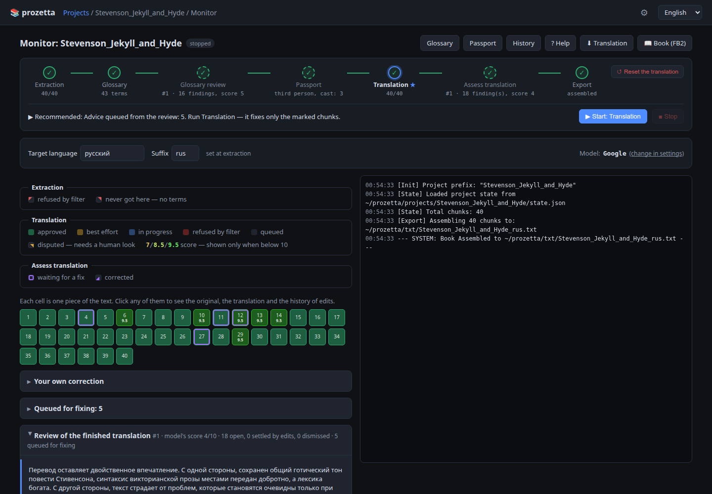
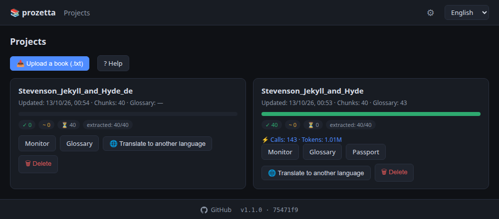
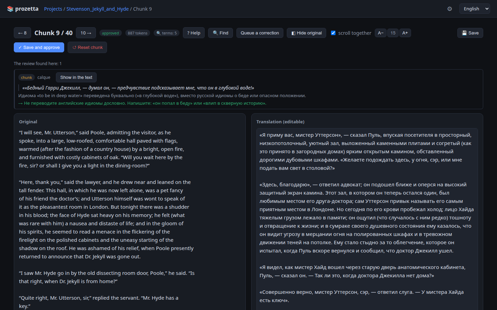

# prozetta

prozetta translates fiction with language models. The text is translated in
parts. Decisions that must hold for the whole book are made once and passed to
every part: how names and terms are spelled, the narrative person, forms of
address, the gender of each character. The program runs locally, through a web
interface in the browser, with a cloud or a local model.

[Русская версия](README.ru.md)



*The monitor for R. L. Stevenson's* Strange Case of Dr Jekyll and Mr Hyde
*(public domain), translated into Russian. Every step is done, and five review
findings are queued for fixing.*

## The problem

A book does not fit into a single model response, so it is translated in parts
of a few thousand characters. When the parts are translated independently, the
translation loses its unity. A character's name acquires several spellings,
informal address turns formal, a minor character changes gender. None of this
can be resolved from inside a single part: the information needed lies in other
parts of the book.

## The approach

The work is split into two levels.

**The book level.** Before translation, the program builds two documents from
the whole text:

- **the glossary**: names, places and terms with their agreed translation,
  gender and a note;
- **the passport**: narrative person and tense, forms of address, the cast with
  genders and short dossiers, how direct speech is set.

**The part level.** Each part is translated separately. Along with it, the model
receives an extract of the glossary, only the terms that occur in that part, and
the relevant parts of the passport. A separate model call checks the draft.
Depending on its score, the part is accepted, corrected or translated again.

Two calls read the book as a whole. The glossary review runs before translation,
the translation review after it. They find what cannot be seen from a single
part: inconsistent terms, a broken register, errors of meaning.

Review findings are not applied automatically: a person accepts or dismisses
each one. Accepted findings are queued on their parts, and the next translation
run corrects only those parts.

Some of the work is done without a model:

- counting where terms occur;
- working out who narrates each part, from names mentioned and the rotation of
  chapters;
- checking how direct speech is set.

## Installation and start

You need [Node.js](https://nodejs.org). The program starts with one script:

```bash
start.bat          # Windows
./start.sh         # macOS, Linux
```

On first run the script installs the dependencies. It then starts the server
and opens `http://127.0.0.1:3457` in the browser. The port is set by the
`GUI_PORT` variable. The server accepts connections from the local address
only.

For newcomers there is a [step-by-step guide](docs/GUIDE.en.md), from
installation and a free Google key to a finished FB2 book. The same guide opens
in the program under Help.

## Models

The program uses models in two roles:

- **The main model** extracts terms, translates and checks parts. There are many
  calls, so cost and speed matter here.
- **The book model** makes the calls that read the whole book: the passport, the
  glossary review, the translation review. There are few such calls, and each
  takes tens or hundreds of thousands of tokens.

You can connect:

- **Google AI Studio.** The free tier is enough for a book.
- **A local server with an OpenAI-compatible interface:** llama.cpp, LM Studio,
  Ollama, vLLM. No key is needed and there is no content filter, so a local
  model can translate parts a cloud model refuses.
- **Any service with an OpenAI-compatible interface,** such as OpenRouter or
  Mistral. The address, key and model name are saved as a preset.

The book model can use a service of its own. For Google models, a thinking level
can be set.

Keys are entered on the settings page. They are stored in
`src_v4/config.overrides.json`, which git does not track.

## How a book is translated

1. **Extraction.** The program reads the book part by part and records names,
   places and terms.
2. **Glossary.** What was recorded is merged into one list, which a person
   checks and corrects.
3. **Glossary review.** The book model checks the list against the text and
   proposes changes: a translation, a gender, a note, a link between forms of one
   name.
4. **Passport.** The book model determines the book-level decisions, and a
   person checks them.
5. **Translation.** Parts are translated in order, each through the review loop.
6. **Translation review.** The book model reads the finished translation and
   lists findings with verbatim quotes.
7. **Export.** The book is assembled into a text file or into FB2 with a cover
   and a table of contents.

Steps 3, 4 and 6 are optional: the book can be translated without them, but
with them the translation is more consistent.

### The review loop for a part

The check gives a score from 0 to 10 and says separately whether the translation
is acceptable as a whole (`like`):

| Check result                 | Action                       |
|------------------------------|------------------------------|
| score ≥ 9.1 and `like = 1`   | the translation is accepted  |
| score ≥ 7.5 and `like = 1`   | the translation is corrected |
| score < 7.5 or `like = 0`    | the part is translated again |

A part gets at most ten attempts, of which at most three are fresh translations.
If no attempt is accepted, the best one is kept. If the translator and the check
never agree, the part is marked as disputed and left to a person. An interrupted
translation resumes from the part where it stopped.

### Whole-book calls

A whole-book call is usually limited not by the model's context window but by
the provider's quota on input tokens per minute. On the free Gemini tier this
quota is stated as 250,000 tokens, but the actual limit is lower. Measured on
gemini-3.8-flash in October 2026: a request of 200,000 tokens (as counted by
`countTokens`) went through, while requests from 225,000 up were refused,
including after several idle minutes. The limit did not depend on the language
of the text.

So by default a call is limited to 200,000 tokens (`bookCallTokenBudget`). For
paid tiers and other providers it can be raised to their own limits.

If a call does not fit the quota, it can be run by hand:

1. the program builds the prompt;
2. the prompt is pasted into a web console, such as Google AI Studio;
3. the answer is pasted back into the program.

An answer obtained by hand goes through the same checks as one from the API.
Only by hand can the original be sent along with the translation. The prompt
doubles in size, but it finds errors of meaning.

### Forms of one name

A book refers to one person in several ways: "Maria Johnson", "Johnson", "Ms
Johnson". Each form stays a separate glossary entry, because it is found in the
text by its own spelling. One entry is made the main one (the prime), and the
others become its clones: a clone's note reads `= Maria Johnson`. A clone takes
its gender and dossier from the prime and keeps only its own translation.

The glossary finds likely forms of one name and shows them as a card, where the
prime and the clones are chosen together. The glossary review can also propose a
link. Details: [docs/GLOSSARY.en.md](docs/GLOSSARY.en.md).

### Corrections

The correction queue holds:

- accepted translation review findings;
- corrections written by hand for one or several parts. Parts are chosen by
  number, by range, or by searching the translation or the original.

The next translation run corrects only the parts that have corrections, with the
same review loop. Everything that changed the translation is recorded in the
history, and any change can be undone.

## The interface

Each screen has a Help button that opens an article about it. The same articles
are in `docs/`.

- [Projects](docs/PROJECTS.en.md): the loaded books. The encoding of a `.txt`
  file is detected automatically. Translating the same book into another
  language reuses the chunking and extraction already done.
- [Monitor](docs/MONITOR.en.md): the state of the book, a recommended next step,
  the chunk map, translation review findings, the correction queue, the run log,
  token spend.
- [Glossary](docs/GLOSSARY.en.md): the term table with search, filters and the
  review.
- [Passport](docs/PASSPORT.en.md): the book-level decisions, open to editing.
- [Chunk editor](docs/CHUNK.en.md): original and translation side by side, the
  review findings for that part, search and replace across the book.
- [History](docs/HISTORY.en.md): every change to the translation, with the
  difference shown and an undo.
- [Book](docs/BOOK.en.md): FB2 assembly.
- [Settings](docs/SETTINGS.en.md): models, connections, thresholds.





## Languages

The target language is set when a project is created and is passed to the model
as a string, so any language the model knows will do.

The calculations made without a model depend on the source language. They count
pronouns to determine the narrative person and gender, and they find direct
speech. Built-in tables cover English, Russian, Ukrainian, Polish, German,
French, Spanish, Italian and Portuguese. For other languages the program asks
the model for a table and accepts it only if the text bears it out: for example,
words named as frequent must actually be frequent. Accepted tables are stored in
`src_v4/language_profiles.json`. If the language cannot be determined, the
program reports that the value was not measured rather than passing off an
empty count as a result.

## Command line

The interface runs the same commands that are available from the command line:

```bash
node src_v4/main.js --stage=<stage> --file=txt/My_Book.txt [--model=google|local|custom]
```

Stages: `extract`, `glossary`, `passport`, `translate`, `review`, `export`.
`--file` is required: it identifies the project. Several books can be processed
at the same time.

```bash
node src_v4/main.js --stage=extract   --file=txt/My_Book.txt --lang=German --suffix=de
node src_v4/main.js --stage=glossary  --file=txt/My_Book.txt   # glossary review
node src_v4/main.js --stage=passport  --file=txt/My_Book.txt
node src_v4/main.js --stage=translate --file=txt/My_Book.txt
node src_v4/main.js --stage=review    --file=txt/My_Book.txt   # translation review
node src_v4/main.js --stage=export    --file=txt/My_Book.txt   # → txt/My_Book_de.txt
```

The target language is set at extraction and stays with the project. When
running from the command line, cloud keys can be passed in the environment
variables `GOOGLE_API_KEY` and `CUSTOM_API_KEY`.

Utility commands:

```bash
node src_v4/tools/reset_to_stage1.js --file=txt/My_Book.txt   # drop the translation, keep the extraction
node src_v4/tools/glossary_hygiene.js --file=txt/My_Book.txt  # a report on the glossary's state
npm run i18n        # interface strings: both languages present, none unused
npm run routes      # every interface request has a handler on the server
npm run changelog   # every commit is recorded in the changelog, in both languages
```

## Configuration

Defaults are in [src_v4/config.js](src_v4/config.js). Changes made in the
interface are written to `src_v4/config.overrides.json`. The main parameters:

- `approvalScoreThreshold`, `redraftScoreThreshold`: the review loop
  thresholds, 9.1 and 7.5 by default.
- `bookCallTokenBudget`: the largest whole-book call, 200,000 tokens by default.
- `targetLanguage`, `langSuffix`: the default target language and file suffix.
  The language is written in the form the model's instructions expect:
  "German" with `promptLang: 'en'`, «немецкий» with `'ru'`.
- `promptLang`: the language of the instructions given to the model (`ru` or
  `en`), not to be confused with the target language.

Models of the Gemma 4 26B class and larger work well as the main model. With
parts of about 1,000 tokens, a reasoning model needs a context of about 32,000
tokens.

## Repository layout

```
src_v4/                 the pipeline
  main.js               command-line entry point
  config.js             parameters and defaults
  prompts.js            instructions for the models
  stages/               stages: extraction, glossary consolidation, passport,
                        glossary review, translation review, translation loop
  core/                 models, project state, chunking, the glossary and links
                        between forms, the passport and narrators, direct speech,
                        reviews, the correction queue, history, book assembly,
                        token accounting
  tools/                utility commands and checks
src_gui/                the web interface over the same pipeline
docs/                   help articles, one per screen
projects/<book>/        a book's state, glossary, passport and reviews
txt/                    source texts and results
```

Book texts and their translations never enter the repository: the `projects/`
and `txt/` directories and the key file are excluded in `.gitignore`.

## License

[MIT](LICENSE).
