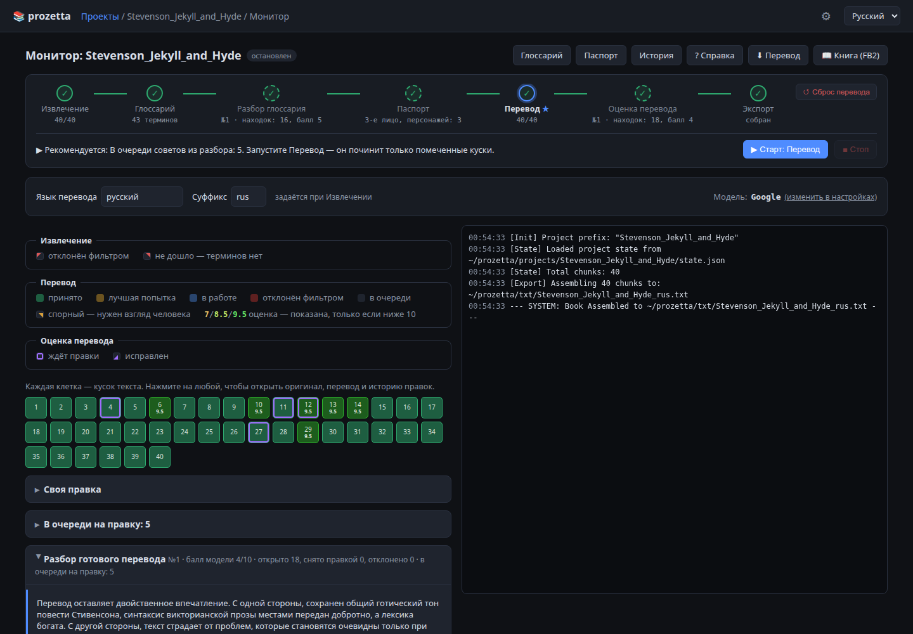
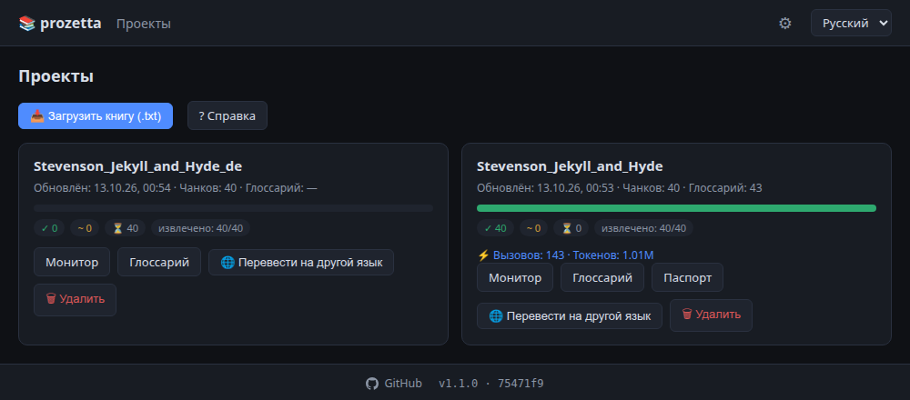
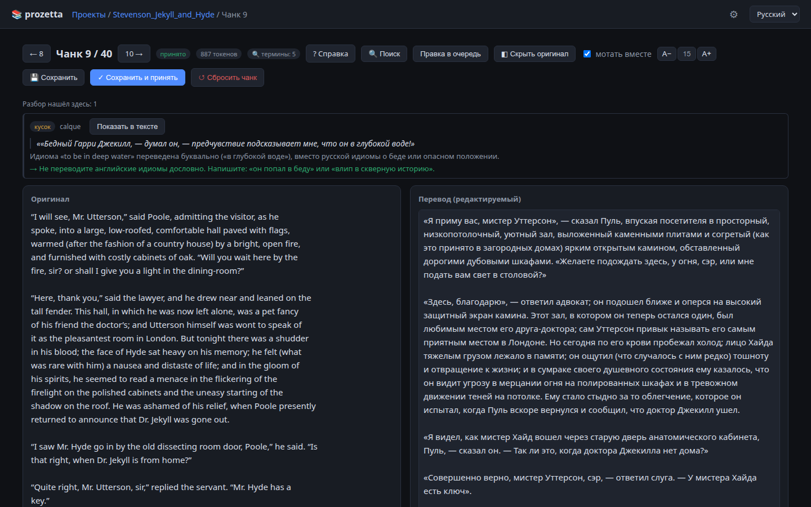

# prozetta

prozetta переводит художественные книги с помощью языковых моделей. Текст
переводится по частям. Решения, которые должны быть общими для всей книги,
принимаются один раз и передаются каждой части. Это написание имён и терминов,
лицо повествования, формы обращения, род персонажей. Программа работает
локально, через веб-интерфейс в браузере, с облачной или локальной моделью.

[English version](README.md)



*Монитор книги: «Странная история доктора Джекила и мистера Хайда» Р. Л.
Стивенсона (общественное достояние), перевод на русский. Все шаги пройдены, пять
находок разбора стоят в очереди на правку.*

## Задача

Книга не помещается в один ответ модели, поэтому её переводят частями по
несколько тысяч символов. Если части переводятся независимо, перевод теряет
единство. Имя персонажа получает несколько написаний, обращение на «ты»
сменяется обращением на «вы», второстепенный персонаж меняет род. Изнутри
отдельной части эти вопросы не решаются: нужные сведения находятся в других
частях книги.

## Подход

Работа делится на два уровня.

**Уровень книги.** До перевода программа собирает по всему тексту два документа:

- **глоссарий**: имена, названия и термины с принятым переводом, родом и
  заметкой;
- **паспорт**: лицо и время повествования, формы обращения, состав персонажей с
  родом и кратким досье, оформление прямой речи.

**Уровень части.** Каждая часть переводится отдельно. Вместе с ней модель
получает выписку из глоссария, только те термины, что в части встречаются, и
нужные сведения из паспорта. Черновик проверяет отдельный вызов модели. По его
оценке часть принимается, исправляется или переводится заново.

Два вызова читают книгу целиком. Разбор глоссария идёт до перевода, оценка
перевода после него. Они находят то, что не видно из отдельной части:
несогласованные термины, сбитый стиль, ошибки смысла.

Находки разборов не применяются автоматически: каждую принимает или отклоняет
человек. Принятые находки встают в очередь на правку своих частей, и следующий
запуск перевода исправляет только эти части.

Часть работы выполняется без модели:

- подсчёт вхождений терминов;
- определение рассказчика каждой части по упоминаниям имён и чередованию глав;
- проверка оформления прямой речи.

## Установка и запуск

Нужен [Node.js](https://nodejs.org). Программа запускается одним скриптом:

```bash
start.bat          # Windows
./start.sh         # macOS, Linux
```

При первом запуске скрипт ставит зависимости. Затем он поднимает сервер и
открывает в браузере `http://127.0.0.1:3457`. Порт задаётся переменной
`GUI_PORT`. Сервер принимает соединения только с локального адреса.

Для новичков есть [пошаговая инструкция](docs/GUIDE.ru.md): от установки и
бесплатного ключа Google до готовой книги в FB2. Та же инструкция открывается в
программе через кнопку «Справка».

## Модели

Программа использует модели в двух ролях:

- **Основная модель** извлекает термины, переводит и проверяет части. Вызовов
  много, поэтому здесь важны цена и скорость.
- **Большая модель** выполняет вызовы, которые читают книгу целиком: паспорт,
  разбор глоссария, оценку перевода. Таких вызовов немного, и каждый занимает
  десятки или сотни тысяч токенов.

Подключить можно:

- **Google AI Studio.** Бесплатного уровня хватает на книгу.
- **Локальный сервер с OpenAI-совместимым интерфейсом:** llama.cpp, LM Studio,
  Ollama, vLLM. Ключ не нужен, фильтра содержимого нет. Поэтому локальная модель
  может перевести части, от которых облачная отказывается.
- **Любой сервис с OpenAI-совместимым интерфейсом,** например OpenRouter или
  Mistral. Адрес, ключ и имя модели сохраняются как пресет.

Для большой модели можно указать отдельный сервис. Для моделей Google можно
задать уровень размышления.

Ключи вводятся на странице настроек. Они хранятся в
`src_v4/config.overrides.json`, этот файл в git не попадает.

## Порядок работы

1. **Извлечение.** Программа читает книгу по частям и выписывает имена, места и
   термины.
2. **Глоссарий.** Выписанное сводится в один список, его проверяет и правит
   человек.
3. **Разбор глоссария.** Большая модель сверяет список с текстом и предлагает
   исправления: перевод, род, заметку, связь форм одного имени.
4. **Паспорт.** Большая модель определяет решения уровня книги, человек их
   проверяет.
5. **Перевод.** Части переводятся по очереди, каждая проходит цикл проверки.
6. **Оценка перевода.** Большая модель читает готовый перевод и выписывает
   находки с дословными цитатами.
7. **Экспорт.** Книга собирается в текстовый файл или в FB2 с обложкой и
   оглавлением.

Шаги 3, 4 и 6 необязательны: перевод возможен и без них, но с ними он
согласованнее.

### Цикл проверки части

Проверка выставляет оценку от 0 до 10 и отдельно отмечает, приемлем ли перевод
в целом (`like`):

| Результат проверки           | Действие                     |
|------------------------------|------------------------------|
| оценка ≥ 9,1 и `like = 1`    | перевод принимается          |
| оценка ≥ 7,5 и `like = 1`    | перевод исправляется         |
| оценка < 7,5 или `like = 0`  | часть переводится заново     |

На часть отводится не больше десяти попыток, из них не больше трёх новых
переводов. Если ни одна попытка не принята, сохраняется лучшая. Если переводчик и
проверка так и не сошлись, часть помечается как спорная и оставляется человеку.
Прерванный перевод продолжается с той части, на которой остановился.

### Вызовы на всю книгу

Вызов на всю книгу обычно упирается не в окно контекста модели, а в квоту
провайдера на входные токены в минуту. На бесплатном уровне Gemini эта квота
объявлена как 250 000 токенов, но фактическая граница ниже. Замеры на
gemini-3.8-flash в октябре 2026 года: запрос в 200 000 токенов (по подсчёту
`countTokens`) прошёл, а запросы от 225 000 отклонялись, в том числе после
нескольких минут без нагрузки. Граница не зависела от языка текста.

Поэтому по умолчанию вызов ограничен 200 000 токенов (параметр
`bookCallTokenBudget`). Для платных тарифов и других провайдеров его можно
поднять до их собственных пределов.

Если вызов не помещается в квоту, его можно выполнить вручную:

1. программа собирает запрос;
2. запрос вставляется в веб-консоль, например Google AI Studio;
3. ответ вставляется обратно в программу.

Ответ, полученный вручную, проходит те же проверки, что и ответ через API.
Только вручную к переводу можно приложить оригинал. Запрос становится вдвое
больше, зато находит ошибки смысла.

### Формы одного имени

Книга называет одного человека по-разному: «Maria Johnson», «Johnson», «Ms
Johnson». Каждая форма остаётся в глоссарии отдельной записью, потому что в
тексте ищется по своему написанию. Одна запись объявляется основной (праймом),
остальные становятся её клонами: в заметке клона стоит `= Maria Johnson`. Клон
берёт у прайма род и досье, а свой у него только перевод.

Глоссарий находит вероятные формы одного имени и показывает их карточкой, где
прайм и клоны выбираются вместе. Разбор глоссария тоже может предложить связь.
Подробности: [docs/GLOSSARY.ru.md](docs/GLOSSARY.ru.md).

### Правки

В очередь на правку попадают:

- принятые находки оценки перевода;
- правки, написанные вручную на одну или несколько частей. Части выбираются
  номерами, диапазонами или поиском по переводу либо оригиналу.

Следующий запуск перевода исправляет только части с правками, тем же циклом
проверки. Всё, что меняло текст перевода, записывается в историю. Любое
изменение можно отменить.

## Интерфейс

У каждого экрана есть кнопка «Справка» со статьёй о нём. Те же статьи лежат в
`docs/`.

- [Проекты](docs/PROJECTS.ru.md): загруженные книги. Кодировка `.txt`
  определяется автоматически. Перевод той же книги на другой язык использует уже
  выполненные нарезку и извлечение.
- [Монитор](docs/MONITOR.ru.md): состояние книги, рекомендация следующего шага,
  карта кусков, находки оценки перевода, очередь правок, журнал выполнения,
  расход токенов.
- [Глоссарий](docs/GLOSSARY.ru.md): таблица терминов с поиском, фильтрами и
  разбором.
- [Паспорт](docs/PASSPORT.ru.md): решения уровня книги, доступные для правки.
- [Редактор куска](docs/CHUNK.ru.md): оригинал и перевод рядом, находки разбора
  по этой части, поиск и замена по всей книге.
- [История](docs/HISTORY.ru.md): все изменения перевода с показом разницы и
  отменой.
- [Книга](docs/BOOK.ru.md): сборка FB2.
- [Настройки](docs/SETTINGS.ru.md): модели, подключения, пороги.





## Языки

Язык перевода задаётся при создании проекта и передаётся модели строкой,
поэтому годится любой язык, который знает модель.

Расчёты без модели зависят от языка оригинала. Это подсчёт местоимений для
определения лица повествования и рода, а также поиск прямой речи. Готовые
таблицы есть для английского, русского, украинского, польского, немецкого,
французского, испанского, итальянского и португальского. Для других языков
программа запрашивает таблицу у модели и принимает её, только если она
подтверждается текстом. Например, слова, названные частыми, действительно
должны часто встречаться. Принятые таблицы сохраняются в
`src_v4/language_profiles.json`. Если язык определить не удалось, программа
сообщает, что величина не измерена, а не выдаёт пустой подсчёт за результат.

## Командная строка

Интерфейс запускает те же команды, что доступны из командной строки:

```bash
node src_v4/main.js --stage=<этап> --file=txt/My_Book.txt [--model=google|local|custom]
```

Этапы: `extract`, `glossary`, `passport`, `translate`, `review`, `export`.
Параметр `--file` обязателен: по нему определяется проект. Несколько книг могут
обрабатываться одновременно.

```bash
node src_v4/main.js --stage=extract   --file=txt/My_Book.txt --lang=немецкий --suffix=de
node src_v4/main.js --stage=glossary  --file=txt/My_Book.txt   # разбор глоссария
node src_v4/main.js --stage=passport  --file=txt/My_Book.txt
node src_v4/main.js --stage=translate --file=txt/My_Book.txt
node src_v4/main.js --stage=review    --file=txt/My_Book.txt   # оценка перевода
node src_v4/main.js --stage=export    --file=txt/My_Book.txt   # → txt/My_Book_de.txt
```

Язык перевода задаётся при извлечении и закрепляется за проектом. При запуске из
командной строки облачные ключи можно передать через переменные окружения
`GOOGLE_API_KEY` и `CUSTOM_API_KEY`.

Служебные команды:

```bash
node src_v4/tools/reset_to_stage1.js --file=txt/My_Book.txt   # снять перевод, сохранить извлечение
node src_v4/tools/glossary_hygiene.js --file=txt/My_Book.txt  # отчёт о состоянии глоссария
npm run i18n        # строки интерфейса: оба языка на месте, неиспользуемых нет
npm run routes      # у каждого запроса интерфейса есть обработчик на сервере
npm run changelog   # каждый коммит записан в истории изменений на обоих языках
```

## Настройка

Значения по умолчанию находятся в [src_v4/config.js](src_v4/config.js).
Изменения, сделанные в интерфейсе, записываются в `src_v4/config.overrides.json`.
Основные параметры:

- `approvalScoreThreshold`, `redraftScoreThreshold`: пороги цикла проверки,
  по умолчанию 9,1 и 7,5.
- `bookCallTokenBudget`: предельный размер вызова на всю книгу, по умолчанию
  200 000 токенов.
- `targetLanguage`, `langSuffix`: язык перевода и суффикс файла по умолчанию.
  Язык пишется в той форме, в какой его ждут инструкции модели: «немецкий» при
  `promptLang: 'ru'`, «German» при `'en'`.
- `promptLang`: язык инструкций для модели (`ru` или `en`), не путать с языком
  перевода.

В качестве основной модели хорошо работают модели уровня Gemma 4 26B и крупнее.
Рассуждающей модели при частях около 1000 токенов нужно около 32 000 токенов
контекста.

## Структура репозитория

```
src_v4/                 конвейер
  main.js               точка входа командной строки
  config.js             параметры и значения по умолчанию
  prompts.js            инструкции для моделей
  stages/               этапы: извлечение, сведение глоссария, паспорт,
                        разбор глоссария, оценка перевода, цикл перевода
  core/                 модели, состояние проекта, нарезка, глоссарий и связи
                        форм, паспорт и рассказчики, прямая речь, разборы,
                        очередь правок, история, сборка книги, учёт токенов
  tools/                служебные команды и проверки
src_gui/                веб-интерфейс поверх того же конвейера
docs/                   справочные статьи, по одной на экран
projects/<книга>/       состояние, глоссарий, паспорт и разборы книги
txt/                    исходные тексты и результаты
```

Тексты книг и их переводы в репозиторий не попадают: каталоги `projects/` и
`txt/`, а также файл с ключами исключены через `.gitignore`.

## Лицензия

[MIT](LICENSE).
